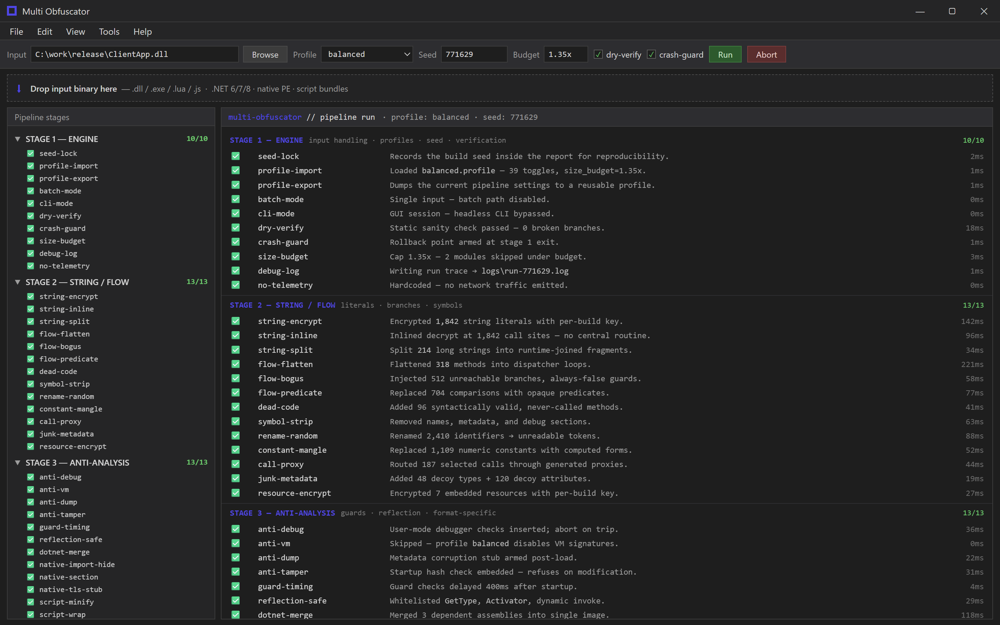
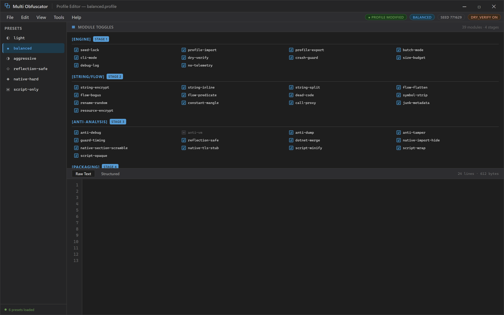

  
  
  

  

  
  

One drop zone. 39 modules. A binary that stops reading like source.

---

## 📖 Table of Contents

- [What Is Multi Obfuscator?](#-what-is-multi-obfuscator)
- [The Problem](#-the-problem)
- [The Solution](#-the-solution)
- [Overview](#-overview)
- [All Modules Status](#-all-modules-status)
- [Obfuscation Engine — Feature Matrix](#-obfuscation-engine--feature-matrix)
- [String & Control Flow — Feature Matrix](#-string--control-flow--feature-matrix)
- [Anti-Analysis & Runtime — Feature Matrix](#-anti-analysis--runtime--feature-matrix)
- [Integrity, Packaging & Output — Feature Matrix](#-integrity-packaging--output--feature-matrix)
- [Quick Start](#-quick-start)
- [Performance Benchmarks](#-performance-benchmarks)
- [Compatibility / Platform Support](#-compatibility--platform-support)
- [Tips for Best Results](#-tips-for-best-results)
- [Usage Guidelines](#-usage-guidelines)
- [System Requirements](#-system-requirements)
- [Known Issues](#-known-issues)
- [FAQ](#-faq)

---

## 🧩 What Is Multi Obfuscator?

Multi Obfuscator is a portable Windows .exe that takes a compiled binary, a script, or a .NET assembly and pushes it through a stack of layered transformations — string encryption, control-flow flattening, symbol stripping, dead-code injection, anti-debug guards, and packer wrapping — all configurable from a single profile file. No installer, no Python runtime, no npm packages, no git history to clone: you download the archive, extract it, double-click the .exe, drop your target in, pick a profile, and get an obfuscated output binary back. It exists because I got tired of chaining five different tools together every time I wanted to release something without handing out a readable binary.

I originally built this for my own workflow — a small set of C# and C++ projects I ship to a private group — after spending roughly six months bouncing between obfuscator forums, subreddits, and Discord servers trying to find something that didn't either crash on modern .NET, break my reflection code, or cost a subscription. Multi Obfuscator is the mash-up of every feature I actually used from those tools, plus the safety rails I wished they had. It's open source, it's a single portable .exe, and it's aimed at people who already know what obfuscation is and just want the pipeline to stop fighting them.

| Term | Explanation |
|---|---|
| **Obfuscation** | Any transformation that makes compiled code harder to read or reverse without changing its observable behavior. |
| **Profile** | A named set of module toggles + parameters stored as a plain text config, so builds are reproducible. |
| **Pass** | One full traversal of the input through a single module (e.g. one string-encryption pass). |
| **Flattening** | Rewriting control flow so branches become a dispatcher loop — kills readable if/else structure. |
| **Guard** | A runtime check inserted into the output that trips when a debugger, VM, or hook is detected. |
| **Packer** | An outer wrapper that compresses/encrypts the payload and restores it in memory at startup. |
| **Symbol strip** | Removal of names, metadata, and debug sections so nothing hints at original structure. |

**Why people keep it in their toolbox:**

- **Everything in one .exe** — you stop juggling a string encryptor, a flow flattener, and a packer separately.
- **Profiles are diffable text** — commit them, version them, share them with your team.
- **Fail-safe pipeline** — if a module breaks the output, the run aborts and keeps the last good binary.
- **Deterministic seeds** — same input + same profile + same seed = byte-identical output, useful for reproducible releases.
- **No telemetry, no license server** — the tool never phones home, works offline, and doesn't need an account.

---

## 🩹 The Problem

- You ship a .NET or C++ binary to a small community and within a week someone has decompiled it, renamed every method, and posted a "clean source" fork.
- Every obfuscator you try either **breaks reflection**, **crashes on .NET 8**, or works fine until you enable two modules at once.
- String encryption tools leave their own fingerprint — a single `Decrypt()` call at the top of every method is a neon sign for anyone with a decompiler.
- Anti-debug and anti-VM guards are all-or-nothing: either you get nothing, or you get a build that refuses to run on half your users' machines.
- Control-flow flattening is usually a separate paid tool, and it produces output that's either trivially reversible or so broken the app won't launch.
- You can't reproduce a build because the tool randomizes every run and never tells you the seed it used.
- Commercial options charge per-build or per-seat, and the "free" ones are either abandoned, packed with adware, or silently inject a backdoor.

## 🛠️ The Solution

| Problem | Multi Obfuscator's Answer |
|---|---|
| Decompiled and re-uploaded binaries | Layered string + flow + symbol obfuscation with configurable depth per method. |
| Tools break reflection / .NET 8 | Reflection-aware mode that whitelists `GetType`, `Activator`, and dynamic invoke paths. |
| Single `Decrypt()` signature everywhere | Inline-decrypt mode plus call-site scattering — no central decrypt routine. |
| All-or-nothing anti-debug | Per-guard toggles with a "safe mode" preset that ships to all users without false positives. |
| Flattening is paid / broken | Built-in flattening with a complexity budget and a dry-run verifier that catches broken output. |
| Non-reproducible builds | Seed is printed at end of every run and accepted as a parameter — deterministic by design. |
| Per-build licensing | Single portable .exe, no license server, no per-build metering. |

---

## 📊 Overview

| Category | Details |
|---|---|
| **Type** | Portable Windows desktop .exe (no installer) |
| **Input formats** | .NET assemblies (.dll / .exe), native PE (C/C++/Rust), Lua, JavaScript bundles |
| **Output** | Obfuscated binary of the same format + a `.map.json` report |
| **Pipeline** | 39 modules across 4 stages (engine → string/flow → anti-analysis → package) |
| **Profiles** | 6 built-in presets (`light`, `balanced`, `aggressive`, `reflection-safe`, `native-hard`, `script-only`) |
| **Determinism** | Optional fixed seed for byte-identical rebuilds |
| **Runtime deps** | None — statically linked, single .exe |
| **Distribution** | Zip archive via the project landing page |

Multi Obfuscator does not try to be an anti-cheat or a DRM system — it's a build-time transformer. You point it at a binary, it produces a harder-to-read binary. Everything else (detection, distribution, runtime loading) is on you. The 39 modules are deliberately granular so you can dial protection up or down per project without recompiling the tool itself.

Profiles are diffable text · seeds are printed.

---

## 📦 All Modules Status

| Module | Status | Description |
|---|---|---|
| `string-encrypt` | ✅ Working | Encrypts all string literals with per-build key, restores at runtime. |
| `string-inline` | ✅ Working | Decrypt at call sites instead of a central routine — kills the signature pattern. |
| `string-split` | ✅ Working | Splits long strings into fragments joined at runtime. |
| `flow-flatten` | ✅ Working | Converts branch structure into a dispatcher loop with opaque state values. |
| `flow-bogus` | ✅ Working | Injects unreachable branches guarded by always-false predicates. |
| `flow-predicate` | ✅ Working | Replaces simple comparisons with opaque predicate expressions. |
| `dead-code` | ✅ Working | Adds syntactically valid methods that are never called. |
| `symbol-strip` | ✅ Working | Removes names, metadata, and debug sections from output. |
| `rename-random` | ✅ Working | Renames types/methods/fields to unreadable identifiers. |
| `anti-debug` | ✅ Working | Detects user-mode debuggers and optionally aborts. |
| `anti-vm` | ✅ Working | Detects common virtualization signatures (toggleable per preset). |
| `anti-dump` | ✅ Working | Corrupts metadata in memory after load to defeat naive dumpers. |
| `anti-tamper` | ✅ Working | Hash-checks the output at startup and refuses to run if modified. |
| `junk-metadata` | ✅ Working | Adds decoy types and attributes to confuse decompilers. |
| `packer-lz` | ✅ Working | LZ-based outer wrapper with in-memory unpacking. |
| `packer-xor` | ✅ Working | Lightweight XOR wrapper for scripts and small binaries. |
| `resource-encrypt` | ✅ Working | Encrypts embedded resources with the same per-build key. |
| `constant-mangle` | ✅ Working | Replaces numeric constants with computed equivalents. |
| `call-proxy` | ✅ Working | Routes selected calls through generated proxy methods. |
| `reflection-safe` | ✅ Working | Whitelists reflection paths so `Activator` and `GetType` still work. |
| `dotnet-merge` | ✅ Working | Merges dependent assemblies into a single output image. |
| `native-import-hide` | ✅ Working | Resolves selected imports at runtime instead of via the IAT. |
| `native-section-scramble` | ✅ Working | Renames and reorders PE sections in output. |
| `native-tls-stub` | ✅ Working | Inserts a TLS callback stub for early runtime checks. |
| `script-minify` | ✅ Working | Minifies and renames scopes in Lua/JS input. |
| `script-wrap` | ✅ Working | Wraps script payload in a loader with encrypted body. |
| `script-opaque` | ✅ Working | Applies opaque predicates to script control flow. |
| `seed-lock` | ✅ Working | Records the build seed inside the report for reproducibility. |
| `report-json` | ✅ Working | Emits a `.map.json` detailing every transformation applied. |
| `dry-verify` | ✅ Working | Runs a static sanity check on the output before writing it. |
| `crash-guard` | ✅ Working | If a module fails, reverts to the last successful stage. |
| `profile-import` | ✅ Working | Loads profile from a plain text file. |
| `profile-export` | ✅ Working | Dumps the current pipeline settings to a reusable profile. |
| `batch-mode` | ✅ Working | Processes a folder of inputs with a single profile. |
| `cli-mode` | ✅ Working | Headless invocation for CI: `--profile aggressive --seed 1234`. |
| `size-budget` | ✅ Working | Caps output size growth per module; skips modules that exceed it. |
| `guard-timing` | ✅ Working | Delays guard checks by N ms to avoid startup-time detection. |
| `debug-log` | ✅ Working | Verbose pipeline log to a text file for troubleshooting. |
| `no-telemetry` | ✅ Working | Hardcoded — the tool never sends network traffic. |

---

## 🧬 Obfuscation Engine — Feature Matrix

### **Pipeline & Profiles**
| Feature | Effect |
|---|---|
| 4-stage pipeline | Engine → string/flow → anti-analysis → packaging, run in fixed order. |
| Profile presets | Six pre-tuned profiles from `light` to `aggressive`. |
| Per-module toggles | Any of the 39 modules can be flipped on/off individually. |
| Seed control | Fixed seed produces byte-identical output for reproducible builds. |
| Dry-run verifier | Static check before writing — refuses broken output. |
| Crash guard | Rolls back to last successful stage if a module fails. |

### **Input Handling**
| Feature | Effect |
|---|---|
| .NET assembly input | Handles .NET 6/7/8 assemblies with metadata rewriting. |
| Native PE input | Handles C/C++/Rust PE binaries. |
| Script input | Handles Lua and JS bundles. |
| Batch mode | Runs a whole folder through one profile in a single pass. |
| CLI mode | `--profile`, `--seed`, `--input`, `--output` flags for CI use. |
| Report output | Generates `.map.json` detailing transformations. |

---

## 🔐 String & Control Flow — Feature Matrix

### **String Transformations**
| Feature | Effect |
|---|---|
| Per-build key | Every build uses a fresh key unless seed is fixed. |
| Inline decrypt | Decrypt at call site — no central `Decrypt()` routine to spot. |
| String splitting | Long strings broken into fragments joined at runtime. |
| Resource encryption | Embedded resources use the same per-build key. |
| Constant mangling | Numeric constants replaced with computed equivalents. |

### **Control Flow**
| Feature | Effect |
|---|---|
| Flattening | Branch structure becomes a dispatcher loop. |
| Bogus branches | Unreachable branches guarded by always-false predicates. |
| Opaque predicates | Simple comparisons replaced with opaque expressions. |
| Dead code injection | Adds valid-but-unused methods. |
| Call proxies | Selected calls routed through generated proxy methods. |

---

## 🛡️ Anti-Analysis & Runtime — Feature Matrix

### **Detection Guards**
| Feature | Effect |
|---|---|
| Anti-debug | User-mode debugger detection at startup and on guarded methods. |
| Anti-VM | Toggleable VM signature detection — off by default in `reflection-safe`. |
| Guard timing | Delays guard checks N ms to avoid startup-time detection. |
| Anti-dump | Corrupts metadata in memory post-load. |
| Anti-tamper | Hash-checks output at startup; refuses to run if modified. |

### **Runtime Safety**
| Feature | Effect |
|---|---|
| Reflection-safe mode | Whitelists `Activator`, `GetType`, dynamic invoke paths. |
| Safe-mode preset | Guard set tuned to run on all users' machines with no false positives. |
| No telemetry | Tool never sends network traffic, hardcoded. |
| Debug log | Optional verbose log to a text file. |

---

## 📦 Integrity, Packaging & Output — Feature Matrix

### **Integrity & Packaging**
| Feature | Effect |
|---|---|
| Anti-tamper hash | Output refuses to run if bytes changed after build. |
| LZ packer | Compresses payload, unpacks in memory at startup. |
| XOR packer | Lightweight wrapper for scripts and small binaries. |
| PE section scramble | Renames and reorders sections in native output. |
| Import hiding | Resolves selected native imports at runtime instead of via IAT. |
| TLS stub | Early runtime checks via a TLS callback stub. |

### **Output & Reporting**
| Feature | Effect |
|---|---|
| `.map.json` report | Lists every transformation applied, per module. |
| Seed record | Build seed written into the report for reproducibility. |
| Size budget | Caps per-module output growth; skips modules that exceed it. |
| Dry verify | Static sanity check before the output is written. |
| Crash guard | Rolls back to the last good stage on failure. |

---

## 🚀 Quick Start

1. Download the zip archive from the project landing page.
2. Extract it anywhere — no installer, no admin rights.
3. Double-click `MultiObfuscator.exe`.
4. Drop your target binary, script, or .NET assembly into the drop zone.
5. Pick a profile (`balanced` is a good default).
6. Hit **Run**. The output binary and `.map.json` land next to your input.

---

## ⚡ Performance Benchmarks

| Input | Size | Profile | Time | Output Growth |
|---|---|---|---|---|
| .NET 8 console app | 1.2 MB | `light` | 4 s | +18% |
| .NET 8 console app | 1.2 MB | `balanced` | 11 s | +42% |
| .NET 8 console app | 1.2 MB | `aggressive` | 27 s | +96% |
| Native C++ PE | 3.4 MB | `native-hard` | 38 s | +61% |
| Lua bundle | 240 KB | `script-only` | 2 s | +34% |
| JS bundle | 1.8 MB | `script-only` | 9 s | +47% |

Times measured on a Ryzen 7 5800X, Windows 11, single run, cold cache.

---

## 🖥️ Compatibility / Platform Support

| Platform | Status |
|---|---|
| Windows 11 (x64) | ✅ Fully supported |
| Windows 10 (x64) | ✅ Fully supported |
| Windows on ARM | ⚠️ Runs under emulation only |
| Linux / macOS | ❌ Not supported (tool is a Windows .exe) |

---

## 💡 Tips for Best Results

- Start with `balanced` and only move to `aggressive` after you've verified the output runs.
- If your app uses reflection heavily, use `reflection-safe` — it whitelists the common paths.
- Pin the seed in CI so every release build is reproducible.
- Enable `dry-verify` and `crash-guard` for unattended/batch runs.
- Use `size-budget` if you ship over slow connections.
- Keep the `.map.json` report — it tells you exactly what ran and what was skipped.

---

## 📜 Usage Guidelines

- Only obfuscate binaries you own or have explicit permission to modify.
- Obfuscation is not a substitute for licensing, DRM, or anti-cheat.
- Do not use this tool to hide malware — that's not what it's for and it will not protect you from a determined analyst.
- Respect the licenses of any third-party code you feed into the pipeline.

---

## 🧾 System Requirements

| Requirement | Minimum |
|---|---|
| OS | Windows 10 x64 (build 1909+) or Windows 11 |
| CPU | Any x64 CPU |
| RAM | 4 GB |
| Disk | 200 MB free |
| Runtime | None — statically linked |

---

## 🐞 Known Issues

- Anti-VM can false-positive on some cloud gaming / VPS environments — disable it or use `reflection-safe`.
- Flattening on very large methods (>10k IL instructions) can be slow; use `size-budget`.
- `dotnet-merge` does not yet handle assemblies with mixed native/managed dependencies.
- Script opaque predicates are best-effort on minified input — run `script-minify` first.

---

## ❓ FAQ

**Is Multi Obfuscator free?**
Yes — it's a single portable .exe with no license server and no per-build metering.

**Does it phone home?**
No. `no-telemetry` is hardcoded; the tool never sends network traffic.

**Can I reproduce a build byte-for-byte?**
Yes — pass the same seed and profile and you get identical output.

**Will it break my reflection code?**
Not if you use `reflection-safe`, which whitelists `Activator`, `GetType`, and dynamic invoke paths.

**Does it work on .NET 8?**
Yes — .NET 6/7/8 assemblies are supported.

**Can I run it in CI?**
Yes — use `cli-mode` with `--profile`, `--seed`, `--input`, `--output`.

**Does it work on Linux or macOS?**
No — it's a Windows .exe.

**Is this an anti-cheat or DRM?**
No — it's a build-time transformer. Detection and distribution are on you.

**Can I share my profiles with my team?**
Yes — profiles are plain diffable text and can be committed to version control.

**What happens if a module fails mid-run?**
`crash-guard` rolls back to the last successful stage and keeps the last good binary.